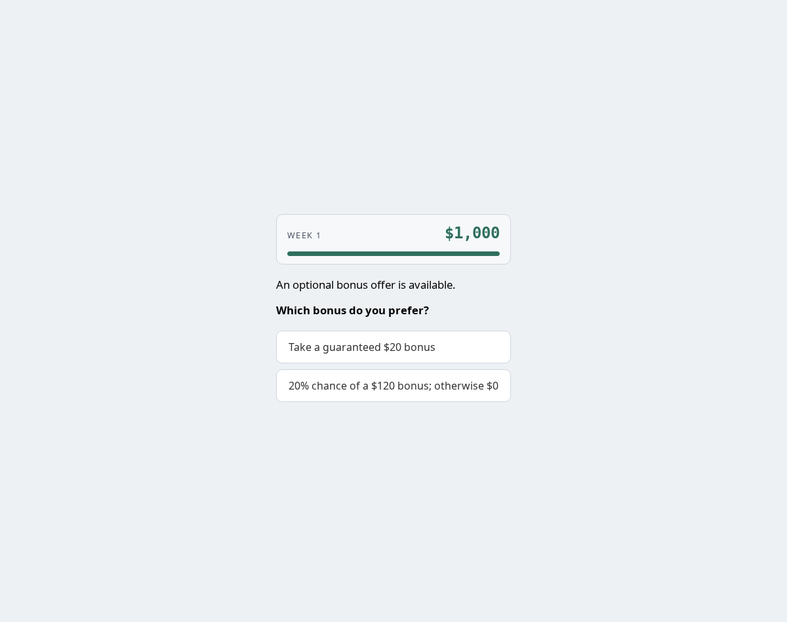

# The Month — Budgeted Choice

**A browser-based decision-task prototype with a reusable jsPsych plugin.**

Participants encounter known-probability gambles, options with undisclosed odds,
guaranteed payoffs, and scripted expenses across a simulated month. The plugin
records how choices update a running balance; the demo provides local CSV/JSON
export. It is not a validated psychological assessment or a real-money task.

[**Open the browser demo**](https://blam3.github.io/the-month/)



## Try it locally

Node.js **22** and npm are used in CI.

```bash
git clone https://github.com/blam3/the-month.git
cd the-month
npm ci
npm run build:demo
npm run dev
```

Open **http://127.0.0.1:8000**. Play through the task, then choose **Download CSV**
or **Download JSON**. The built demo serves all assets locally; no CDN or API
key is needed. Responses are not uploaded. Use `?seed=my-seed` to select a seed;
repeatability requires the same choices and dependency versions.

## Use the plugin

This standalone package is named `@blam3/plugin-budgeted-choice`. It is not
published to npm and is not an official jspsych-contrib package. Build and pack
locally instead of using the old, unverified registry/CDN installation links:

```bash
npm run build
npm pack
# In your experiment project:
npm install /path/to/blam3-plugin-budgeted-choice-0.1.1.tgz jspsych@8.2.1
```

```js
import BudgetedChoice from '@blam3/plugin-budgeted-choice';

const budget = { value: 1000 };
const trial = {
  type: BudgetedChoice,
  balance: () => budget.value,
  options: [
    { label: 'Sure $20', win: 20, p: 1, tag: 'sure' },
    { label: '50% chance of $50, otherwise $0', win: 50, lose: 0, p: .5, tag: 'gamble' },
  ],
  on_finish: data => { budget.value = data.balance_after; },
};
```

The plugin leaves budget state to your experiment. ESM, CommonJS, TypeScript
declarations, and a browser global build are provided in `dist/`. The browser
global is `jsPsychBudgetedChoice`, loaded after jsPsych 8.2.1. This is browser
software; importing jsPsych in a server-only Node process requires a browser-like
environment. See [parameters and data](budgeted-choice.md).

## Verified data export

The example exports **21 ledger rows: 15 decisions and 6 expenses**. Automated
browser checks download both formats and verify every balance update, expense
amount, displayed-option reconstruction, and repeatable seeded outcomes.

[CSV example](examples/exports/demo.csv) · [JSON example](examples/exports/demo.json) ·
[Verification report](examples/exports/verification.json) · [Export schema](docs/export.md)

These examples were produced by automated interaction and are not research
participant data. Response times and session identifiers vary between runs.

## Check the package and demo

```bash
npm run typecheck
npm test
npm run build:pages
npm run check:package
npm pack --dry-run
npx playwright install chromium
npm run test:browser
```

CI runs the same checks, verifies generated outputs match source, and uploads
browser-export artifacts. Tests exercise deterministic/stochastic choices,
ambiguity flags, negative payoffs, repeated clicks, invalid probabilities, and
consistent data-only/visual simulation. Browser tests complete the full example.

`npm run build:pages` also prepares the tracked `docs/` static demo for GitHub
Pages with **main /docs** as its source. Rebuild it whenever plugin or example
code changes. Third-party notices accompany the browser assets.

## Scientific status

Trial labels such as ambiguity, likelihood sensitivity, or desperation describe
intended probes, not established measurements of those constructs. The example
confounds trial order, available offers, and budget history, so it cannot by
itself identify causal scarcity effects or individual trait parameters. Budget
need not decrease monotonically because choices can pay out. The browser source
contains the hidden probabilities; this prototype does not conceal them from
technical inspection.

See [evaluation status](evaluation/README.md) for the legacy recovery scaffold
and the validation work required before research use. No psychometric validity
claim is based on passing the software tests.

## Layout and provenance

- `src/`: TypeScript plugin source; version generated from package metadata
- `dist/`: generated ESM, CommonJS, browser build, and declarations
- `examples/the-month.html`: task source
- `scripts/`: build preparation, local server, packaging and browser checks
- `tests/`: plugin behavior checks
- `docs/`: static demo, export contract, screenshot and third-party notices

Maintained by Brendan Lam. Packaging and verification were developed with AI
assistance; scientific validation remains separate. [Changes](CHANGELOG.md).
Code: [MIT](LICENSE). jsPsych and bundled dependencies retain their respective
[notices](docs/THIRD-PARTY-NOTICES.txt).
